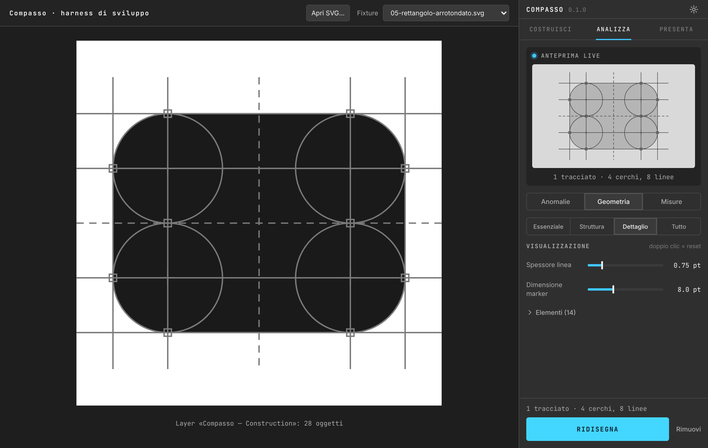
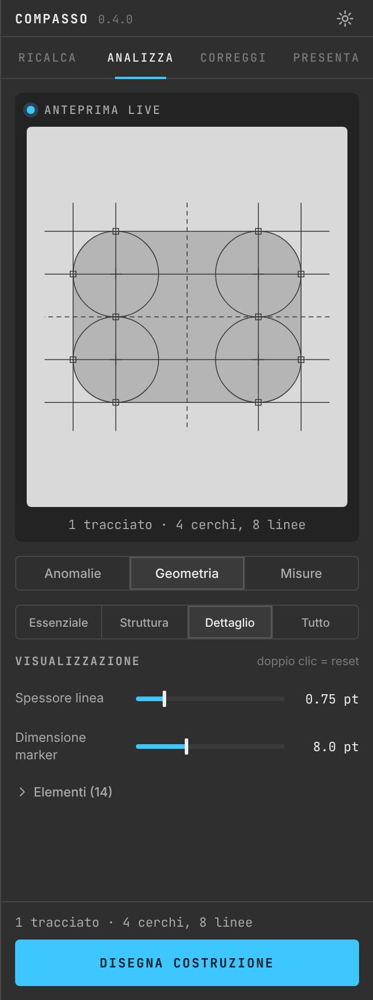
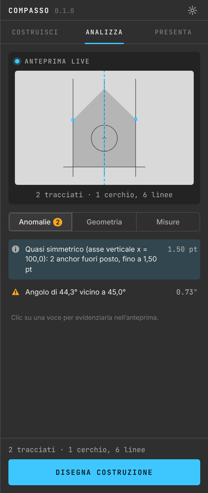
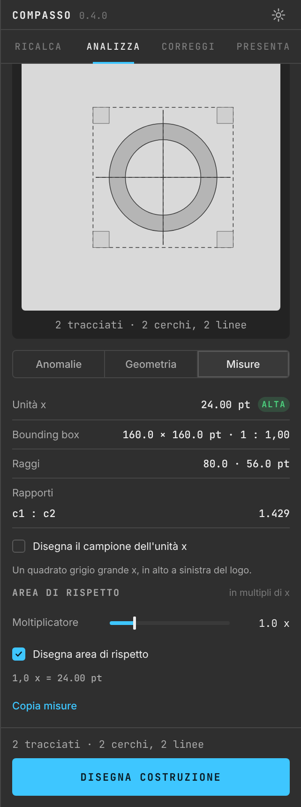

# Compasso

**La costruzione geometrica del tuo logo, dedotta dai suoi tracciati.**
Plugin per Adobe Illustrator: selezioni il logo, Compasso trova i cerchi che le curve seguono,
le rette, gli assi di simmetria, l'unità x e l'area di rispetto, e la disegna su un layer dedicato.
In più ti segnala le imprecisioni invisibili: una curva circolare al 99%, due raggi diversi
dell'1%, un anchor fuori riga di 0,3 pt.



> **Anteprima (beta) 0.1.1** — per Adobe Illustrator 2026 (v31) e successivi, Windows e macOS.

## Scarica e installa (1 minuto)

1. **Scarica** [Compasso-Windows-macOS.zip](../../releases/latest/download/Compasso-Windows-macOS.zip)
   (oppure dalla pagina [Releases](../../releases)) ed **estrai tutto** lo ZIP.
2. **Chiudi Illustrator** e fai doppio clic su:
   - Windows: **`Installa Compasso (Windows).bat`** — se compare «Windows ha protetto il PC»: _Ulteriori informazioni → Esegui comunque_
   - macOS: **`Installa Compasso (macOS).command`** — se macOS lo blocca: _clic destro → Apri → Apri_
3. Apri Illustrator → **Finestra → Estensioni → Compasso** (nelle versioni recenti: **Estensioni (legacy)**).

L'installer usa l'installatore ufficiale di Adobe (incluso in Creative Cloud): non modifica
impostazioni di sicurezza. Usi già [ZXP Installer](https://aescripts.com/learn/zxp-installer/)?
Scarica solo [Compasso.zxp](../../releases/latest/download/Compasso.zxp) e trascinalo nella sua finestra.

Per disinstallare: doppio clic su `Disinstalla Compasso (…)` nella stessa cartella.

## Come si usa

|                                               |                                                                                                                                                                                                                                                                                                                                                                                                                                                 |
| --------------------------------------------- | ----------------------------------------------------------------------------------------------------------------------------------------------------------------------------------------------------------------------------------------------------------------------------------------------------------------------------------------------------------------------------------------------------------------------------------------------- |
|  | **1. Seleziona il logo** — tracciati, gruppi, tracciati composti o testo. L'anteprima si aggiorna da sola.<br><br>**2. Scegli il livello** — Essenziale, Struttura, Dettaglio o Tutto; regola spessore delle linee e marker. Dall'elenco _Elementi_ includi o escludi ogni cerchio e retta.<br><br>**3. DISEGNA COSTRUZIONE** — la costruzione va sul layer bloccato «Compasso — Construction». _RIDISEGNA_ la aggiorna, _Rimuovi_ la cancella. |
|    | **Anomalie** — le quasi-coincidenze, ordinate per importanza: quasi-archi, raggi quasi uguali, centri quasi coincidenti, quasi-tangenze, anchor fuori riga, quasi-simmetrie, angoli quasi a 45°/90°. Un clic le evidenzia nell'anteprima.                                                                                                                                                                                                       |
|        | **Misure** — unità x (spessore dell'asta) con affidabilità, proporzioni, raggi e rapporti notevoli (aureo, √2…), area di rispetto in multipli di x, _Copia misure_.                                                                                                                                                                                                                                                                             |

**Logo disegnato a mano?** Fotografalo, vettorializzalo con _Oggetto → Ricalco immagine_, poi
selezionalo e imposta ⚙ → **Tolleranza → Morbida**: Compasso ti mostra la costruzione che il
disegno «voleva» avere e dove si discosta.

Lingua dell'interfaccia: ⚙ → English / Italiano.

## Domande frequenti

- **Non vedo Compasso in Finestra → Estensioni.** Riavvia Illustrator e guarda anche in _Estensioni (legacy)_. Su Windows fai doppio clic su `Diagnostica Compasso (Windows).bat` (solo lettura): salva sul Desktop `compasso-diagnostica.txt` da allegare alla segnalazione.
- **L'installer dice che non trova Creative Cloud.** Usa [ZXP Installer](https://aescripts.com/learn/zxp-installer/) con il file `Compasso.zxp`.
- **Il documento cambia?** Solo quando premi DISEGNA: tutto finisce sul layer «Compasso — Construction», che puoi eliminare con _Rimuovi_. L'anteprima non tocca il documento.
- **Raccoglie dati?** No. Funziona solo in locale, anche offline.

## Novità

Vedi il [CHANGELOG](CHANGELOG.md). In arrivo: **Costruisci** (progressioni di cerchi, griglie,
«Ricostruisci perfetto») e **Presenta** (tavola di presentazione del logo).

---

## Per sviluppatori

Monorepo pnpm (Node 22, `corepack enable`):

| Cartella           | Contenuto                                                                  |
| ------------------ | -------------------------------------------------------------------------- |
| `packages/core`    | motore geometrico in TypeScript puro (`analyze()`, `plan()`, `parseSvg()`) |
| `packages/ui`      | pannello Svelte 5, token, testi EN/IT                                      |
| `apps/harness`     | ambiente web di sviluppo: trascini un SVG e provi il pannello              |
| `apps/illustrator` | pannello CEP per Illustrator (Bolt CEP) e ExtendScript                     |
| `fixtures/`        | SVG di test e risultati attesi (golden test)                               |
| `installer/`       | installer a doppio clic inclusi nello ZIP                                  |

```bash
pnpm install
pnpm dev                   # harness su http://localhost:5173
pnpm test && pnpm typecheck && pnpm lint
pnpm -F illustrator build  # pannello in apps/illustrator/dist/cep
```

Nuova release: aumenta `version` in `apps/illustrator/package.json` e fai push su `main` →
GitHub Actions firma `Compasso.zxp` su Windows, compone lo ZIP, crea il tag `v<versione>` e pubblica la release.
Specifica completa: [`docs/SPEC.md`](docs/SPEC.md) · stato: [`docs/STATO.md`](docs/STATO.md).

Copyright © 2026 Marco Dolce — vedi [LICENSE](LICENSE.md) e [componenti di terze parti](THIRD-PARTY-NOTICES.md).
